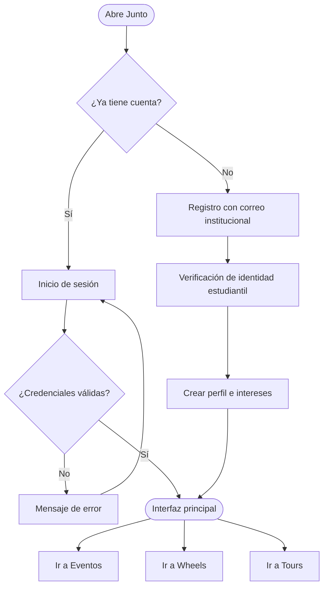

[Documentación](../README.md) › [04 · Flujos](README.md) › Acceso y registro

# Flujo A · Acceso y registro

## Diagrama

---

## Paso a paso

### 1 · Abre Junto
Landing con prueba social del campus: número de estudiantes en línea y sello de «100% estudiantes».

### 2 · ¿Ya tiene cuenta?

| Respuesta | Destino |
|---|---|
| Sí | Inicio de sesión |
| No | Registro con correo institucional |

### 3 · Rama de inicio de sesión

Correo institucional y contraseña.

**¿Credenciales válidas?**

| Respuesta | Qué pasa |
|---|---|
| No | Mensaje de error y regreso al formulario. El prototipo explica la condición: usar un correo `.edu.co` y una contraseña de 4 o más caracteres |
| Sí | Entra a la interfaz principal |

### 4 · Rama de registro — paso 1 de 3
Correo de la universidad. Se envía un código de 4 dígitos, con contador de reenvío.

### 5 · Rama de registro — paso 2 de 3
Verificación de identidad estudiantil: carné o certificado de matrícula vigente. Revisión en menos de 24 horas.

### 6 · Rama de registro — paso 3 de 3
Crear perfil: foto, nombre e intereses.

### 7 · Interfaz principal
Saludo personalizado, próximo plan del usuario y tres accesos de módulo con su estado actual:

- Eventos — planes en tu campus hoy
- Wheels — rutas que pasan cerca de ti
- Tours — viajes abiertos este mes

---

## Notas de diseño

- **El error no castiga:** el mensaje de credenciales inválidas explica qué se espera, en vez de limitarse a negar el acceso.
- **La verificación no bloquea la exploración del registro:** el usuario avanza por los tres pasos aunque la revisión documental tarde hasta 24 horas.
- **La interfaz principal no es un menú:** abre con el próximo plan del usuario, no con las opciones.

---

## Pantallas asociadas

Ver [Inventario de pantallas · Acceso y registro](../05-interfaz/01-inventario-pantallas.md).

---

**Siguiente:** [02 · Flujo Eventos](02-flujo-eventos.md)
