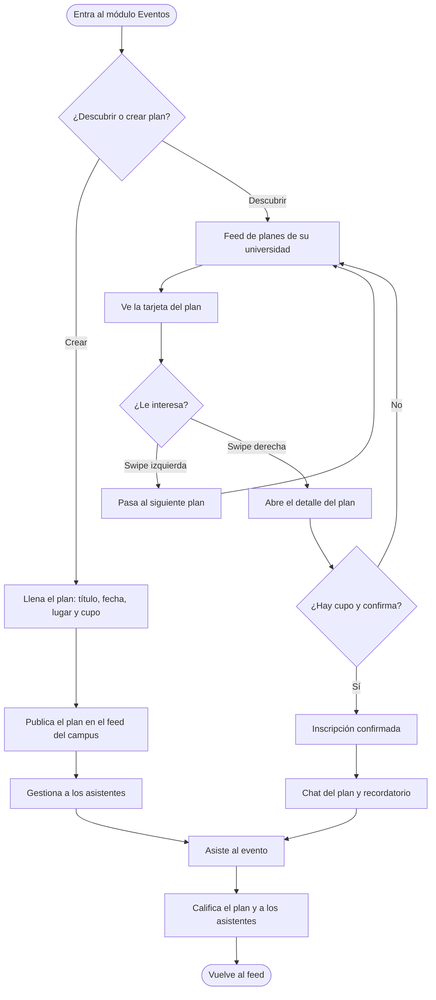

[Documentación](../README.md) › [04 · Flujos](README.md) › Flujo Eventos

# Flujo B · Eventos

## Diagrama

---

## Rama «Crear»

### 1 · Llena el plan
Título, fecha y hora, lugar y cupo. Además:
- Tipo: evento o ruta Wheels
- Quién puede unirse: *todo mi campus* o *apruebo yo*

### 2 · Publica el plan en el feed del campus
El plan entra al feed de swipe de todos los estudiantes verificados de la universidad.

### 3 · Gestiona a los asistentes
Panel del organizador: vistas, unidos y bandeja de solicitudes con aceptar o rechazar.

### 4 · Asiste al evento
El organizador recibe los códigos de asistencia de quienes llegan.

---

## Rama «Descubrir»

### 1 · Feed de planes de su universidad
Solo planes del propio campus. Filtros disponibles.

### 2 · Ve la tarjeta del plan
Icono o foto, fecha y hora, título, lugar y cupos.

### 3 · ¿Le interesa?

| Gesto | Qué pasa |
|---|---|
| **Swipe izquierda** | Pasa al siguiente plan y continúa en el feed |
| **Swipe derecha** | Abre el detalle del plan |

### 4 · Detalle del plan
Organizador verificado con calificación, «Quién va», etiquetas, y la opción de reportar.

### 5 · ¿Hay cupo y confirma?

| Caso | Qué pasa |
|---|---|
| **No hay cupo** | Pantalla «Este plan se llenó», con opción de avisarme si se libera, y regreso al feed |
| **Hay cupo, no confirma** | Regresa al feed |
| **Hay cupo y confirma** | Pasa por la pantalla de confirmación —cupos, plazo de cancelación, aviso de calificación— y queda inscrito |

### 6 · Inscripción confirmada
Pantalla «¡Estás dentro!» con recordatorio una hora antes y acceso al chat del plan.

### 7 · Chat del plan y recordatorio
Mensaje fijado del organizador con la hora y el punto de encuentro.

---

## Tronco común

### 8 · Asiste al evento
El día del plan: mapa del punto de encuentro, código de asistencia de 4 dígitos, «Ya llegué» y «Avisar que voy tarde».

### 9 · Califica el plan y a los asistentes
Calificación del plan con estrellas y valoración individual de cada asistente.

### 10 · Vuelve al feed
Cierre del ciclo con «Enviar y ver más planes», que devuelve directamente al descubrimiento.

---

## Salidas alternas

| Salida | Desde dónde | Resultado |
|---|---|---|
| Plan lleno | Detalle del plan | Aviso de liberación de cupo |
| Cancelar asistencia dentro del plazo | Mis planes o chat | Cupo liberado, salida del chat, aviso al organizador |
| Cancelar fuera del plazo | Mis planes | Solo aviso en el chat; afecta la calificación |

Ver [Estados límite](../05-interfaz/03-estados-limite.md).

---

**Anterior:** [01 · Acceso y registro](01-acceso-y-registro.md) · **Siguiente:** [03 · Flujo Wheels](03-flujo-wheels.md) · **Módulo:** [Eventos](../03-producto/02-modulo-eventos.md)
