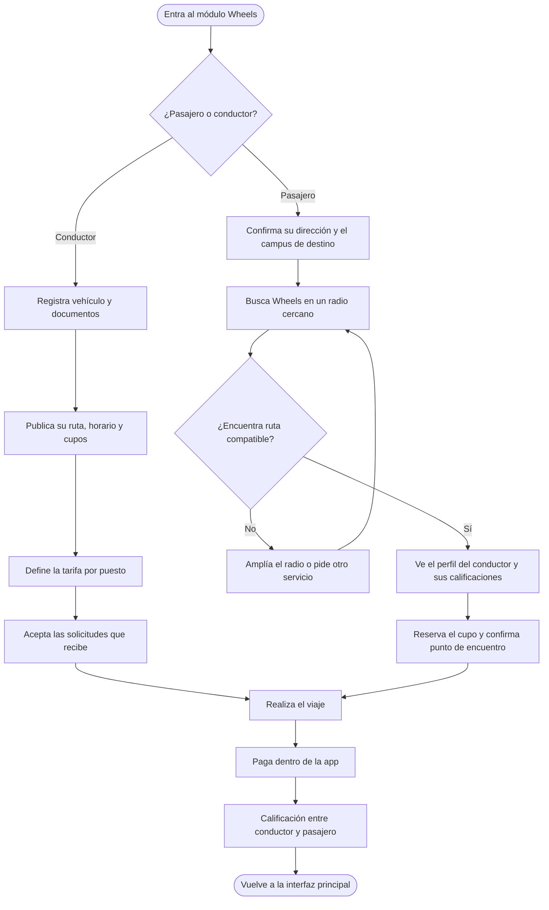

[Documentación](../README.md) › [04 · Flujos](README.md) › Flujo Wheels

# Flujo C · Wheels

## Diagrama

---

## Rama «Conductor»

### 1 · Registra vehículo y documentos
Paso 1 de 3. Licencia, SOAT y tecnomecánica. Se hace una sola vez y queda en revisión.

> El prototipo lo plantea como requisito previo: «Para publicar rutas como conductor necesitamos licencia, SOAT y tecnomecánica». Ofrece además una salida: «¿Solo buscas cupo? Como pasajero no necesitas crear nada».

### 2 · Publica su ruta, horario y cupos
Paso 2 de 3. Trazado de la ruta, hora de salida, cupos y días de la semana.

### 3 · Define la tarifa por puesto
Rango sugerido: **$5.500 – $7.000**.

### 4 · Acepta las solicitudes que recibe
Paso 3 de 3. Bandeja de solicitudes con aceptar o rechazar, y botón de iniciar viaje.

---

## Rama «Pasajero»

### 1 · Confirma su dirección y el campus de destino
Origen con mapa, campus de destino, hora de llegada y días.

### 2 · Busca Wheels en un radio cercano
Radio de búsqueda ajustable.

### 3 · ¿Encuentra ruta compatible?

| Respuesta | Qué pasa |
|---|---|
| **No** | «Nadie pasa tan cerca»: ampliar el radio a 2 km, o pedir aviso cuando aparezca una ruta. Vuelve a buscar |
| **Sí** | Pasa al perfil del conductor |

### 4 · Ve el perfil del conductor y sus calificaciones
Licencia verificada, calificación, número de viajes, puntualidad, vehículo con placa y SOAT vigente, y reseñas de otros pasajeros.

### 5 · Reserva el cupo y confirma punto de encuentro
Punto de recogida editable, horario y días, precio por puesto. El pago queda diferido al final del viaje.

---

## Tronco común

### 6 · Realiza el viaje
Mapa en vivo, botón SOS, llamada y chat.

- **Vista del pasajero:** estado del viaje y datos del conductor.
- **Vista del conductor:** lista de pasajeros, cobro individual durante el trayecto y botón de finalizar viaje.

### 7 · Paga dentro de la app

| Concepto | Valor |
|---|---|
| Puesto | Tarifa del conductor |
| Servicio | $600 |
| Total | Suma de ambos |

Métodos de pago seleccionables en la misma pantalla.

### 8 · Calificación entre conductor y pasajero
Ambas partes califican. El conductor ve además el resumen de ganancias del día, con la nota de que el dinero se abona cuando los pasajeros pagan en la app.

### 9 · Vuelve a la interfaz principal

---

**Anterior:** [02 · Flujo Eventos](02-flujo-eventos.md) · **Siguiente:** [04 · Flujo Tours](04-flujo-tours.md) · **Módulo:** [Wheels](../03-producto/03-modulo-wheels.md)
