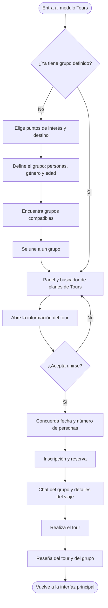

[Documentación](../README.md) › [04 · Flujos](README.md) › Flujo Tours

# Flujo D · Tours

## Diagrama

---

## Rama «No tengo grupo»

### 1 · Elige puntos de interés y destino
Paso 1 de 3. Tipo de viaje y destino, con sugerencias cercanas a Bogotá.

### 2 · Define el grupo
Paso 2 de 3. Tamaño del grupo, género y rango de edad (18 – 24 años por defecto).

### 3 · Encuentra grupos compatibles
Paso 3 de 3. Lista con porcentaje de afinidad, número de personas, composición y etiquetas de interés.

### 4 · Se une a un grupo
A partir de aquí el recorrido es el mismo que el de quien ya tenía grupo.

---

## Tronco común

### 5 · Panel y buscador de planes de Tours
Catálogo con filtros de duración y precio.

### 6 · Abre la información del tour
Foto del destino, fecha, punto de salida, qué incluye (transporte, guía, almuerzo), operador verificado, cupos y precio por persona.

### 7 · ¿Acepta unirse?

| Respuesta | Qué pasa |
|---|---|
| **No** | «No me convence, ver otros» y regreso al panel |
| **Sí** | Pasa a la coordinación con el grupo |

### 8 · Concuerda fecha y número de personas
Selección de fecha entre opciones, cuántos van, y confirmaciones individuales de cada integrante del grupo.

### 9 · Inscripción y reserva

| Concepto | Valor |
|---|---|
| Total | Personas × precio por persona |
| Abono hoy | 30% del total |
| Forma de pago | Cada uno su parte, o pago único |
| Condición | Aceptar la política de cancelación |

### 10 · Chat del grupo y detalles del viaje
Detalles fijados: hora de salida, punto de encuentro y qué llevar. El guía participa en la conversación.

### 11 · Realiza el tour

### 12 · Reseña del tour y del grupo
Calificación del tour y del operador, valoración del grupo y subida de fotos del viaje.

### 13 · Vuelve a la interfaz principal

---

## Nota sobre la doble entrada

El punto de convergencia es el **panel de Tours**: quien llega con grupo y quien llega solo recorren exactamente lo mismo a partir de ahí. El emparejamiento es un prefijo del flujo, no un flujo paralelo.

---

**Anterior:** [03 · Flujo Wheels](03-flujo-wheels.md) · **Siguiente:** [05 · Cambios entre versiones](05-cambios-entre-versiones.md) · **Módulo:** [Tours](../03-producto/04-modulo-tours.md)
