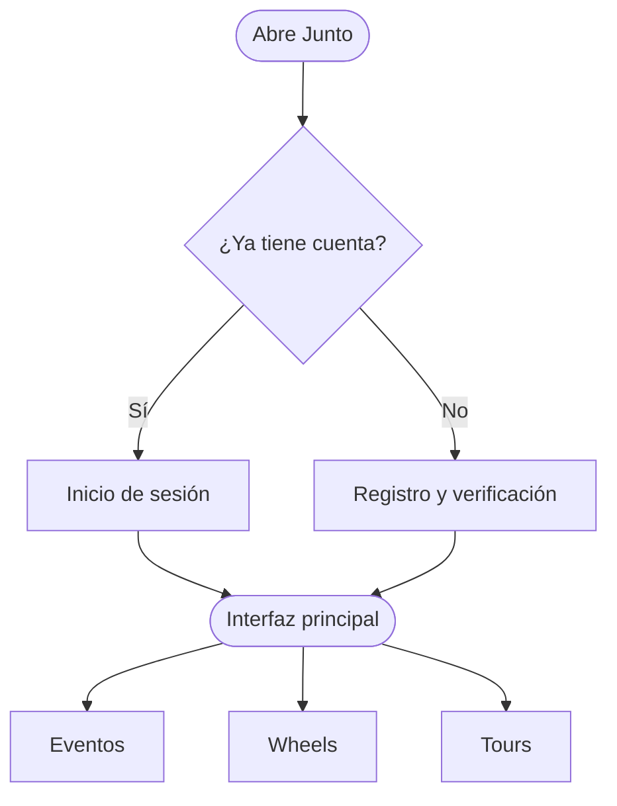

# 04 · Flujos

Transcripción del diagrama de FigJam, segunda versión. Cada flujo incluye un diagrama Mermaid y la descripción paso a paso.

| Documento | Contenido |
|---|---|
| [01 · Acceso y registro](01-acceso-y-registro.md) | De abrir la app a la interfaz principal |
| [02 · Flujo Eventos](02-flujo-eventos.md) | Descubrir o crear, inscripción, asistencia y calificación |
| [03 · Flujo Wheels](03-flujo-wheels.md) | Pasajero y conductor, hasta el pago |
| [04 · Flujo Tours](04-flujo-tours.md) | Con grupo o solo, hasta la reseña |
| [05 · Cambios entre versiones](05-cambios-entre-versiones.md) | Qué cambió de la primera a la segunda versión y por qué |

---

## Convenciones

| Forma | Significado |
|---|---|
| Rectángulo redondeado | Inicio o final del flujo |
| Rectángulo | Paso o pantalla |
| Rombo | Decisión del usuario o del sistema |

En los diagramas Mermaid: `([texto])` para inicio y final, `[texto]` para pasos, `{texto}` para decisiones.

---

## Mapa general

**Fuente:** [Diagrama de flujo en FigJam](https://www.figma.com/board/xIzglMlvBBqPUCMYuZ64w3), sección «Segunda versión del flujo».

**Anterior:** [03 · Producto](../03-producto/) · **Siguiente:** [05 · Interfaz](../05-interfaz/)
